# Command-Line Interface

See the [Reference Manual](/docs/latest/cli.html) for a complete list of `scenedetect` commands and options.

## Quickstart

Split a video at each fast cut using `ffmpeg`:

```bash
scenedetect -i video.mp4 split-video
```

Save still frames from each scene:

```bash
scenedetect -i video.mp4 save-images
```

Skip the first 10 seconds of the video:

```bash
scenedetect -i video.mp4 time -s 10s
```

## Example

This walkthrough uses a short clip from the James Bond film *GoldenEye* (Copyright &copy; 1995 MGM):

- [Watch the clip on YouTube](https://www.youtube.com/watch?v=OMgIPnCnlbQ)
- [Download `goldeneye.mp4`](https://github.com/Breakthrough/PySceneDetect/raw/refs/heads/resources/tests/resources/goldeneye.mp4) (right-click and save it in your working directory as `goldeneye.mp4`)

To split this clip on each fast cut, use the adaptive detector (`detect-adaptive`) or the content detector (`detect-content`). To detect fades to and from black instead, use `detect-threshold`. When you do not specify a detector, PySceneDetect uses `detect-adaptive` by default.

Start by saving a CSV scene list and preview images for each scene:

```bash
scenedetect --input goldeneye.mp4 detect-adaptive list-scenes save-images
```

This command creates `goldeneye-Scenes.csv` and three preview images per scene in your working directory (starting with `goldeneye-Scene-001-01.jpg`). The output matches the scenes below:

| Scene # | Start Time | Preview |
| --- | --- | --- |
| 1 | 00:00:00.000 | 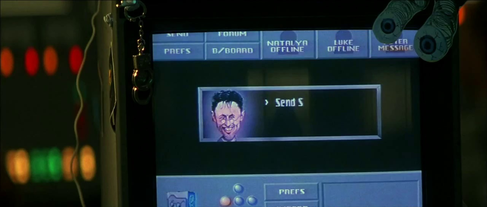 |
| 2 | 00:00:03.754 | 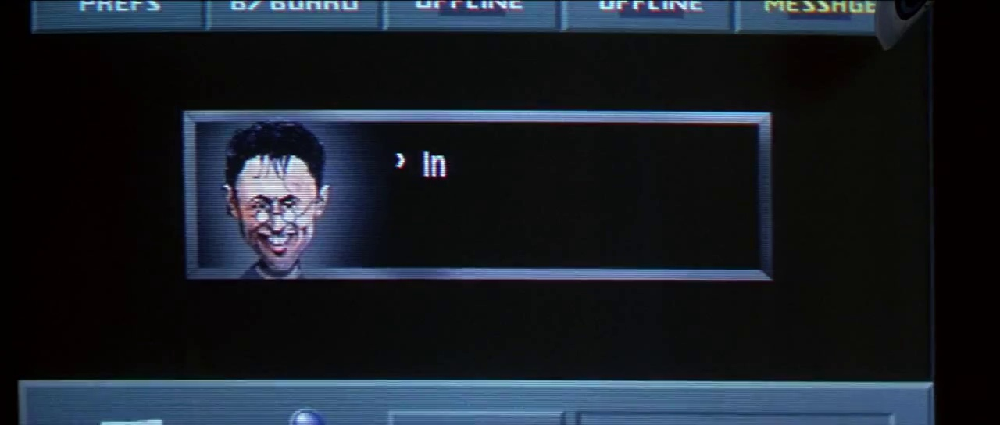 |
| 3 | 00:00:08.759 | 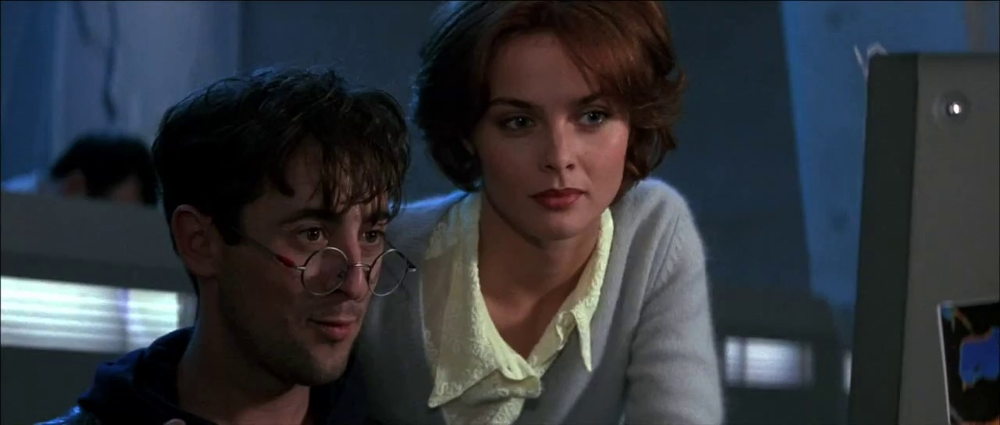 |
| 4 | 00:00:10.802 |  |
| 5 | 00:00:15.599 | 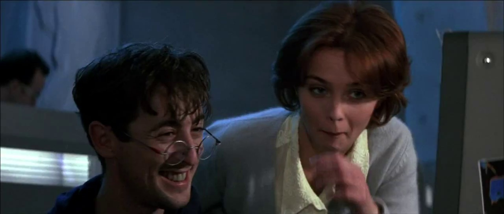 |
| 6 | 00:00:27.110 | 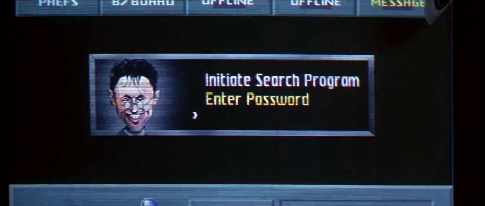 |
| 7 | 00:00:34.117 | 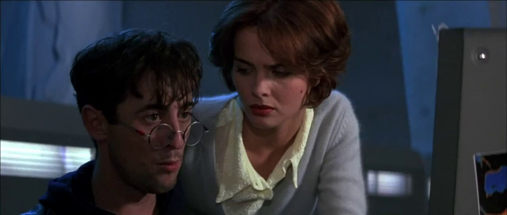 |
| 8 | 00:00:36.536 | 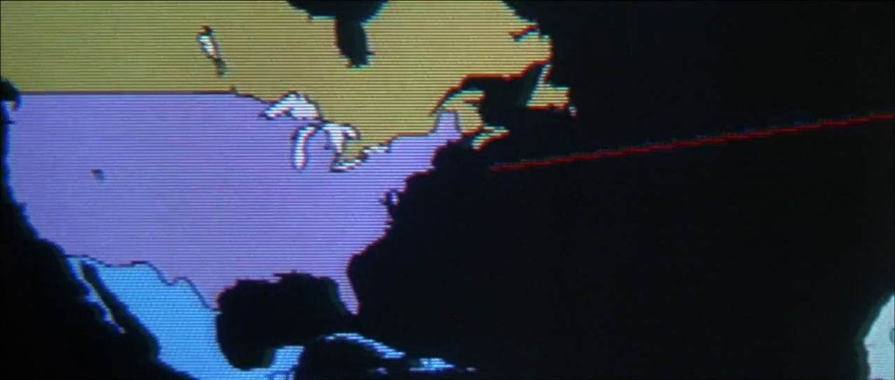 |
| ... | ... | ... |
| 18 | 00:01:06.316 | 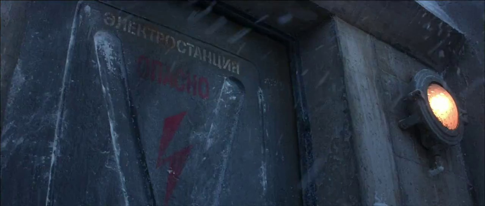 |
| 19 | 00:01:10.779 | 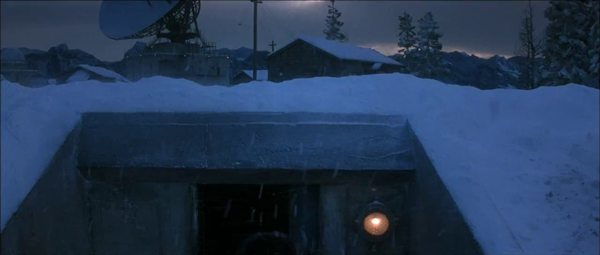 |
| 20 | 00:01:18.036 | 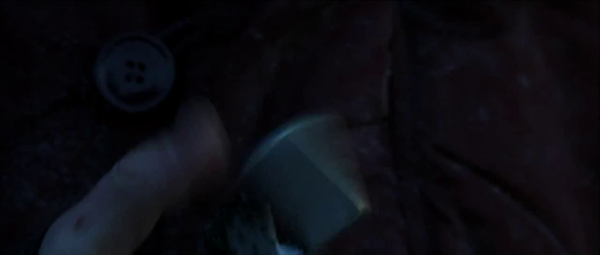 |
| 21 | 00:01:19.913 | 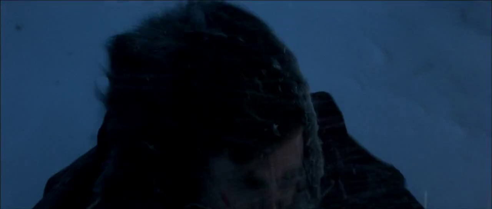 |
| 22 | 00:01:21.999 | 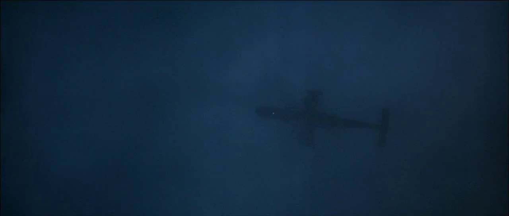 |

## Splitting Video into Clips

Use the `split-video` command to split the input video with `ffmpeg` or `mkvmerge`:

```bash
scenedetect -i goldeneye.mp4 split-video
```

By default, `split-video` re-encodes each clip with `ffmpeg` for frame-accurate cuts. You can adjust encoding quality with `-hq` / `--high-quality` (near-lossless), `-p` / `--preset`, and `-crf` / `--rate-factor`.

For faster splitting without re-encoding, pass `-c` / `--copy` (uses `ffmpeg` stream copy) or `-m` / `--mkvmerge` (uses `mkvmerge`). Stream copy splits only on keyframes, so clip boundaries may not be frame-accurate. Run `scenedetect split-video --help` for all options.

## Detectors

PySceneDetect includes five detectors:

- `detect-adaptive` (default): finds fast cuts by comparing each frame's content score against a rolling average of nearby frames.
- `detect-content`: finds fast cuts by comparing differences in HSV color and optional edges between adjacent frames.
- `detect-hash`: finds fast cuts by comparing perceptual hashes of adjacent frames.
- `detect-hist`: finds fast cuts by comparing Y-channel (brightness) histograms of adjacent frames.
- `detect-threshold`: finds fades to and from black by comparing average frame brightness against a threshold.

Most detector options can also be set in a [config file](/docs/latest/cli/config_file.html).

Use `detect-adaptive` or `detect-content` for videos with fast cuts between scenes. Use `detect-threshold` for videos separated by fades to black. If the default settings miss cuts or report false cuts, generate a stats file with `-s` / `--stats` to choose a better threshold.

### Adaptive detector

`detect-adaptive` compares each frame's `content_val` score against the average of nearby frames and records the ratio in the stats file under `adaptive_ratio (w=2)` (the `w=` suffix matches `--frame-window`). This reduces false cuts during fast camera movement. Adjust the window size with `--frame-window` and the minimum content score with `--min-content-val`.

### Content detector

`detect-content` measures the difference between each pair of adjacent frames and records a cut when the difference exceeds the threshold (default: `27.0`).

To find the best threshold, generate a stats file with `-s`, open it in a spreadsheet editor, and check the `content_val` column ([example](img/goldeneye-stats.png)). This value stays low within a scene and spikes when the scene changes. Choose a threshold above normal motion scores and below the spikes at real cuts.

### Threshold detector

`detect-threshold` measures the average RGB brightness of each frame (from `0.0` to `255.0`) and records a fade event when brightness crosses the threshold. The default threshold is `12.0`:

```bash
scenedetect -i video.mp4 -s video.stats.csv detect-threshold
```

```bash
scenedetect -i video.mp4 -s video.stats.csv detect-threshold -t 20
```

Thresholds below `8.0` can cause missed detections on videos with low bitrates or limited brightness range.

To tune the threshold, generate a stats file with `-s` and inspect the `average_rgb` column in a spreadsheet editor. Choose a threshold below the brightness of normal scenes and above the dark fade frames.

## Detector Options

You can configure detector options on the [command line](/docs/latest/cli.html#detectors) or in a [config file](/docs/latest/cli/config_file.html).

If the default threshold does not give the results you want, generate a stats file first:

```bash
scenedetect --input goldeneye.mp4 --stats goldeneye.stats.csv detect-adaptive
```

Then plot the `content_val` or `adaptive_ratio (w=2)` column from `goldeneye.stats.csv`:

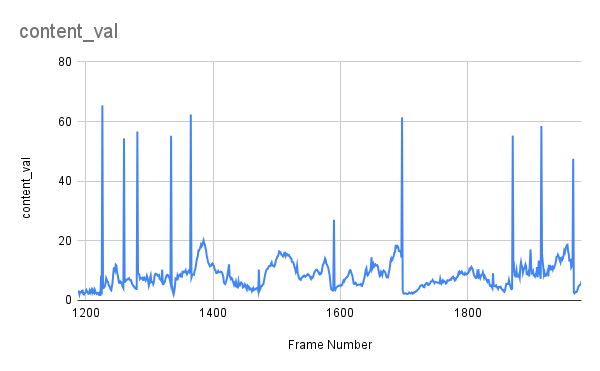

Peaks in the graph match the scene cuts in the video. For fast-cut detectors, raise the threshold to reduce false cuts or lower it to catch missed cuts. For `detect-threshold`, do the opposite: raise `-t` to catch more fades or lower it to reduce false detections.

## Saving Image Previews of Detected Scenes

Use `save-images` to save still frames from each detected scene in your working directory (or the folder set with `-o` / `--output`).

By default, `save-images` saves three JPEG images per scene (start, middle, and end), numbered `01`, `02`, and `03` (for example, `goldeneye-Scene-001-01.jpg`). Use `-n` / `--num-images` to choose a different fixed count per scene, or `-i` / `--interval` to save one image per time interval so longer scenes produce more images. Run `scenedetect save-images --help` for format, size, and quality options.

## Improving Processing Speed

These global options go before any command (such as `detect-adaptive` or `list-scenes`). They speed up processing at the cost of some accuracy:

- **Downscaling (`-d` / `--downscale`)**: shrinks each frame by an integer factor (`2`, `3`, `4`, and so on) before analysis. By default, PySceneDetect picks a downscale factor automatically based on video resolution. Pass `-d 1` to disable downscaling, or a higher integer to process frames faster.
- **Frame skipping (`-fs` / `--frame-skip`)**: skips `N` frames after every processed frame. For example, `--frame-skip 1` processes every second frame and roughly doubles speed.

Frame skipping reduces cut accuracy. You cannot use it together with a stats file (`-s` / `--stats`). Because skipped frames increase the difference between adjacent processed frames, large values can cause false cuts even inside the same scene. Use `-fs` only on high-frame-rate video (above 60 FPS) with small values such as `1` or `2`.

## Seeking, Duration, and Start / End Times

Use the `time` command to analyze only part of a video. It accepts three options:

- `-s` / `--start`: where to begin detection.
- `-e` / `--end`: where to stop detection.
- `-d` / `--duration`: how much video to process after the start time.

Set either `--end` or `--duration`, not both. You can write times in seconds (`100.0` or `100s`), frames (`100`), or `HH:MM:SS[.nnn]` timecode (`00:05:00.000`).

For a 30 FPS video, all four commands below analyze the same 90-second segment (2700 frames) between `00:05:00` and `00:06:30`:

```bash
scenedetect -i video.mp4 time --start 00:05:00 --end 00:06:30
```

```bash
scenedetect -i video.mp4 time --start 300s --end 390s
```

```bash
scenedetect -i video.mp4 time --start 300s --duration 90s
```

```bash
scenedetect -i video.mp4 time --start 300s --duration 2700
```

## Config File

Pass a config file path with `-c` / `--config`. If you do not pass `-c`, PySceneDetect checks for `scenedetect.cfg` in your platform's default user config folder:

- Windows:
    - `C:/Users/%USERNAME%/AppData/Local/PySceneDetect/scenedetect.cfg`
- Linux:
    - `~/.config/PySceneDetect/scenedetect.cfg`
    - `$XDG_CONFIG_HOME/PySceneDetect/scenedetect.cfg`
- macOS:
    - `~/Library/Application Support/PySceneDetect/scenedetect.cfg`

Run `scenedetect --help` to see the exact path on your system under the `-c` / `--config` help text. You can [download the `scenedetect.cfg` template from GitHub](https://github.com/Breakthrough/PySceneDetect/blob/latest/scenedetect.cfg), or copy it from the PySceneDetect installation folder when using the Windows builds. Lines starting with `#` are comments and are ignored.

Options passed on the command line override values in the config file, and `-c` / `--config` overrides the default user config file.

Config files use INI syntax:

```ini
[command]
option_a = value
# comment
option_b = 1
```

### Example

```ini
[global]
default-detector = detect-content
min-scene-len = 0.8s

[detect-content]
threshold = 32
weights = 1.0 0.5 1.0 0.2

[split-video]
preset = slow
rate-factor = 17
# Quotes are not needed even if the filename contains spaces
filename = $VIDEO_NAME-Clip-$SCENE_NUMBER

[save-images]
format = jpeg
quality = 80
num-images = 3
```

See the [Configuration File Reference](/docs/latest/cli/config_file.html) or [the `scenedetect.cfg` template on GitHub](https://github.com/Breakthrough/PySceneDetect/blob/latest/scenedetect.cfg) for every available key.

## Video Splitting Requirements

PySceneDetect uses `ffmpeg` or `mkvmerge` to split videos:

- `split-video` (default): uses `ffmpeg` and re-encodes for frame-accurate splits.
- `split-video -c` / `--copy`: uses `ffmpeg` in stream-copy mode.
- `split-video -m` / `--mkvmerge`: uses `mkvmerge` in stream-copy mode.

### FFmpeg

Download `ffmpeg` from [FFmpeg](https://ffmpeg.org/download.html). On Linux, install it with your package manager (for example, `sudo apt-get install ffmpeg`). On Windows, the PySceneDetect builds bundle `ffmpeg`; otherwise follow the steps below.

### mkvmerge

Download `mkvmerge` as part of [MKVToolNix](https://mkvtoolnix.download/downloads.html). Use the installer on Windows or your system package manager on Linux so PySceneDetect can find `mkvmerge` automatically.

### Enabling `split-video` support

If PySceneDetect cannot find `ffmpeg` or `mkvmerge`, use one of these approaches:

1. Add the folder containing `ffmpeg` or `mkvmerge` to your system `PATH` environment variable so it works from any terminal (recommended).
2. Copy `ffmpeg` or `mkvmerge` into the same folder where `scenedetect` is installed (on Windows with `pip`, typically `C:\PythonXY\Scripts`) if you prefer not to edit `PATH`.
3. Copy the executable into a folder already on `PATH` if neither of the above is possible.
